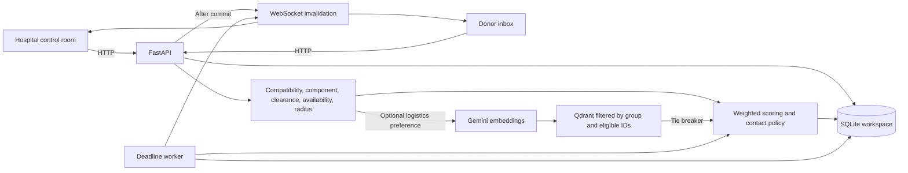

# Blood Buddy technical evaluation

Blood Buddy coordinates synthetic hospital requests from the first invitation through collection. The strongest demonstration is to pick a donor who was skipped, inspect the reasons saved at dispatch, then watch the hospital recover from a decline without anyone clicking “Match again”.

## Competitive comparison

The competitor columns summarize the products’ own public descriptions. Only Blood Buddy was executed in this evaluation. [Haemologix FAQ](https://www.haemologix.in/faq) · [CIVI product walkthrough](https://civiapp.in/)

| Workflow | Haemologix | CIVI | Blood Buddy |
|---|---|---|---|
| Common foundation | Targeted emergency requests, donor availability, live acceptance, ETA | Nearby compatible donors, availability, acceptance, ETA and fulfilment tracking | Component-specific outreach rules, availability, live commitments and donor-entered ETA |
| Primary user | Hospitals and blood banks, institutional onboarding and stock alerts | Families, donors and community organizers, including camps | Coordinator at one synthetic hospital with separate donor inboxes |
| Reach | SMS and email, expandable search radius | Emergency Mode expands outreach from 10 to 20 km | Three timed waves, in-app invitations, expiry, cooldown, daily cap and escalation to Overview |
| Trust | Describes verification of institutional accounts | Supports a prescription photo and community reporting | Flags similar open requests and records a local coordinator review. Institutional identity is unverified |
| Inspectability | FAQ explains targeting criteria | Public walkthrough explains radius and status progression | Replayable per-donor input, exclusion, score and contact decision for each run |

Alerts, ETA and wider searches are common capabilities. The opportunity is to let a hospital test its dispatch policy and explain individual decisions. The cited pages establish no basis for claiming an exclusive feature or better patient outcomes.

## Five-minute demonstration

| Time | Action | What the judge can verify |
|---|---|---|
| 0:00–0:45 | Open Hospital → **Start fresh demo**. Submit the prefilled critical O− whole-blood request for one unit. | A fresh workspace has 16 synthetic donors. Wave 1 contacts donor #1. |
| 0:45–1:30 | Open **Match explanations** and expand the first run. | Compare donor #1’s score with #2’s. Inspect #4’s future clearance date, #5’s pause and #8’s incompatible group. The snapshot survives later changes. |
| 1:30–2:15 | Open #1’s inbox and decline. Keep the hospital tab visible. | The activity timeline records the decline. The donor’s notification history counts a reply. |
| 2:15–3:15 | Inspect wave 2, open donor #2’s inbox, and accept. | The hospital shows one committed unit and covered status. Remaining open offers retract. No refresh is needed. |
| 3:15–4:15 | Share a travel estimate, mark departure and arrival, then record collection in the hospital tab. | The request becomes fulfilled only after collection. Stock and recorded analytics update. |
| 4:15–5:00 | Reopen the first decision run and compare it with the activity timeline. Show the donor’s contact history. | Explain who was skipped, why a different person could be contacted and exactly when the unit was secured. |

For this paced presentation, set `WAVE_SECONDS=100` and `INVITE_SECONDS=180` in `server/.env` before starting FastAPI. With the quicker defaults, decline within the first 45 seconds and move to donor #2 as soon as wave 2 opens. To show escalation separately, start a fresh run and leave it uncovered through the third wave’s deadline. Start fresh demo allocates another workspace and preserves prior runs.

## Architecture and policy

1. SQLite supplies the authoritative donor records. The service applies component-specific blood policy, component support, clearance date, availability, commitments and radius before any vector operation. Final dispatch checks the current records again inside the write transaction. The demo’s outreach rules and seeded clearance dates require external blood-bank screening.
2. The score awards up to 40 points for group compatibility, 25 for proximity, 15 for a clearance record, 12 for response history and 8 for recent activity. Response history starts with a fictional ten-invitation baseline. Acceptances and declines both count as replies. Expired unanswered invitations enter the denominator. Retractions and pending offers do not.
3. Automatic dispatch prioritizes fewer invitations in the last rolling 24 hours, then higher coordination score, then optional similarity and stable donor ID. A 900-second cooldown and three-per-day limit also apply to manual contact. An actual invitation can be sent only once per donor and request. A manual invite can increase the number of outstanding offers, while a write transaction still limits the number of commitments.
4. Every 45 seconds by default, the scheduler checks the next wave. Wave 1 budgets one pending invitation per outstanding unit, wave 2 budgets two and wave 3 budgets three and expands to at least 15 km. Each invitation expires after 90 seconds by default. After the third deadline an uncovered request appears in the coordinator’s escalation list. Pause, closure and coverage suppress automatic outreach. Thresholds are in `server/.env.example`.
5. A selected logistics preference compares synthetic notes about transport, shift timing or wayfinding. Gemini embeds the text and Qdrant searches the eligible IDs. Similarity can break a coordination-score tie. Structured requests skip both providers. Provider errors preserve a local ranking and a visible explanation. The explicit cloud preview endpoint remains available. There is no generated answer stage or measured evidence that embeddings improve donation rates.

## Storage and interfaces

| SQLite table | Durable contents |
|---|---|
| hospital, donor | Demo account preferences, donor ID, group, component support, fixture distance, activity baseline, clearance and availability |
| request | Request ID, unique creation token, requirement, creation time, radius, closure and retrieval source |
| request_review | Request ID, optional logistics preference, similar request ID and review timestamp |
| dispatch | One row per request with current wave, next deadline and escalation flag |
| decision | Append-only run ID, request, timestamp, wave, radius and per-donor decision JSON |
| invitation | Composite request/donor key, state, score, score factors, similarity, invitation and response times, shared ETA |
| activity | Ordered request and donor events with timestamps, including invitations and responses used for fatigue history |
| stock | Available synthetic units by component and group |
| stock_issue | One stock decrement per unique submission token, with group, component, issue date in UTC and units |
| stock_day | Confirmed full-day usage totals keyed by blood group, component and UTC date |

Each workspace has a separate SQLite file. Existing workspaces acquire the new tables on access. Historical decisions predating this version have no reconstructed explanation. Earlier requests retain manual dispatch unless they already have a scheduled deadline.

| Method and route | Contract |
|---|---|
| GET /api/health | Service status and presence of provider configuration |
| GET /api/workspace | Hospital, requests with review and dispatch state, offers, donors with contact history, stock and events |
| POST /api/stock/issues | Atomically issue available units for a blood group and component. A UUID token makes retries idempotent. |
| POST /api/stock/daily-usage | Enter or correct a completed day's total for the stock outlook, including an explicit zero. Returns 409 for a total below recorded issues. |
| POST /api/requests | Create using a UUID idempotency token and optional preset logistics preference. Similar open requests with matching group, component, units and urgency within 30 minutes are flagged for review |
| GET /api/requests/{rid}/decisions | Frozen matching runs, newest first |
| POST /api/requests/{rid}/review | Record the demo coordinator’s review once |
| POST /api/requests/{rid}/rematch | Re-evaluate current records, optionally with `expand=true` |
| POST /api/requests/{rid}/offers/{donor} | Invite, accept, decline, depart, arrive, withdraw or record collection under transition guards |
| POST /api/requests/{rid}/offers/{donor}/eta, .../contact | Share or clear a donor estimate, or send an in-app preset reminder |
| POST /api/requests/{rid}/close | Close or cancel a request |
| POST /api/donors/{id}/availability, /api/hospital/settings | Update donor availability or automatic invitations |
| POST /api/admin/seed, /api/requests/match | Index synthetic logistics profiles or explicitly preview cloud retrieval |

Workspace operations take a UUID `room` query parameter. Each WebSocket subscribes at `/ws/requests/{requestId-or-workspace}?room={uuid}`. The server sends `{"event":"ready"}` on connect and replies to text `ping` with `pong`. A committed change sends an invalidation such as `{"event":"dispatch.wave","requests":["REQ-…"]}`. Clients refetch SQLite-backed state and resynchronize after reconnect.

| Event names | Trigger |
|---|---|
| request.created, request.matched, request.reviewed, request.cancelled, request.closed | Request creation, rematch, review or closure |
| dispatch.wave, dispatch.escalated | Scheduled wave or coordinator escalation |
| invitation.invited, invitation.accepted, invitation.declined, invitation.expired, invitation.retracted | Offer sent, answered, timed out or retracted across requests |
| invitation.en_route, invitation.arrived, invitation.withdrawn, invitation.donated | Commitment progress, release or collection |
| donor.availability, donor.eta, hospital.settings, inbox.message | Availability, arrival estimate, preference or hospital reminder |
| stock.issued, stock.usage | Workspace inventory balance or historical usage changed |

Coverage and fulfilment are visible on the snapshot fetched after the corresponding invitation event. WebSocket frames carry IDs and event names. The synthetic workspace allows role switching, so all records in it are visible to its local participants.

## Strict evaluation

**Why would a hospital choose Blood Buddy?** For an internal dispatch-policy exercise, the coordinator can replay why each donor was contacted, see the effect of a decline, and check whether the system respected the notification budget. A judge can reproduce that claim with two browser tabs. A procurement recommendation for real emergency care would require operational, security and clinical evidence beyond this demo.

* **Implemented locally.** SQLite persistence, actual timed dispatch, scoped WebSockets, race-safe commitments, decision history, metrics derived from events, request review, synthetic stock updates and repeatable workspace reset.
* **Inventory outlook.** Hospital → Blood Stock compares current availability with the issued units in the previous seven complete UTC days. Confirm each day's total for a group and component in Daily usage history. Zero is a valid reported value. Any missing day leaves the estimate pending. Once complete, projected shortfall is the positive difference between last week's total and today's balance. Editing history recalculates the estimate. Current issues, recorded collections, stock receipts and confirmed physical counts change the available balance. This baseline assumes unchanged usage and excludes future supply, expiries and unmet demand.
* **Simulated or incomplete.** All people, institutional identity, clearance records, starting stock and distances are fixtures. ETAs are voluntary estimates. Notifications and coordinator escalation are in-app. Hindi is available for invitation responses and pausing. Full localization, document verification, external messaging and clinical integration remain open. Stock outlook accuracy has not been evaluated on hospital data.
* **Security and reliability.** Loopback access and workspace separation support a local demo. Production needs authenticated principals, authorization by role, retention controls and tamper-resistant audit storage. One worker polls workspace files every two seconds. All-workspace refreshes, full decision snapshots, serial provider calls and in-process socket subscriptions impose scaling limits. Timers resume from persisted deadlines when the service returns. There is no uptime, throughput, delivery or clinical-outcome benchmark.
* **Evidence.** The backend suite exercises all 24 group/component policy combinations, retries, concurrent last-unit acceptance, provider failures, scheduled dispatch, cooldown, expiry, escalation and review. Browser QA covers a two-unit request, independent hospital and donor tabs, connectivity recovery, a second-wave Hindi decline/accept scenario and 18 route/state cases at five widths. Deadline tests move stored due times forward to exercise the normal worker without waiting for presentation-length timers. Local provider tests use the actual Gemini SDK with a deterministic HTTP transport and real in-memory Qdrant. Hosted connectivity has not been established.

## Files changed for this upgrade

| Area | Files |
|---|---|
| Service and persistence | `server/config.py`, `server/.env.example`, `server/database.py`, `server/coordination.py`, `server/main.py`, `server/models.py`, `server/matching_router.py` |
| Retrieval | `server/seed_donors.py`, `server/vector_store.py` |
| Hospital and donor interfaces | `src/lib/api/workspace.ts`, `src/pages/hospital/NewRequestPage.tsx`, `src/pages/hospital/RequestDetailPage.tsx`, `src/pages/hospital/OverviewPage.tsx`, `src/pages/donor/DonorHomePage.tsx` |
| Verification and handoff | `server/test_coordination.py`, `server/test_integration.py`, `server/qa_browser.py`, `README.md`, `server/README.md`, `HACKATHON.md` |

See the [local setup and verification commands](README.md#run-locally).
