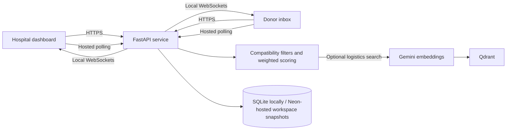

# Blood Buddy

Blood Buddy is a hackathon demonstration of emergency blood donor coordination. A hospital can create a request, inspect why donors were selected or excluded, send invitations in timed waves, and follow responses through collection. Donor inboxes and hospital views share the same synthetic workspace.

**[Try the live demo](https://blood-buddy-dusky.vercel.app)** · [Technical evaluation](HACKATHON.md) · [Interaction audit](INTERACTION_AUDIT.md) · [Backend guide](server/README.md)

> This is a synthetic demonstration. It has no individual user authentication, clinical verification, real donor directory, or external notification delivery. Do not enter real patient, hospital, or donor data.

## The problem

During an urgent blood request, a coordinator needs to identify suitable donors, avoid contacting the same people repeatedly, and track who has committed. Blood Buddy demonstrates this workflow with an explainable ranking, invitation history, and a shared request timeline.

## Main features

- **Hospital workspace** for creating and tracking requests, reviewing potential duplicates, and inspecting candidate scores and exclusions.
- **Donor inbox** for accepting or declining invitations, sharing a travel estimate, pausing availability, and recording progress.
- **Invitation waves** that broaden outreach, expire unanswered invitations, apply cooldowns, and flag outstanding needs for a coordinator.
- **Audit history and analytics** based on recorded workspace activity, including invitation responses and request status.
- **Inventory and stock outlook** with recorded receipts, issues and counts, plus a simple seven-day estimate when usage history is complete.
- **Optional semantic retrieval** using Gemini embeddings and Qdrant for synthetic donor logistics notes. Structured matching works locally without provider keys.

## Try the demo

1. Open the [live app](https://blood-buddy-dusky.vercel.app), choose **Hospital**, then **Start fresh demo**.
2. Walk through the four request steps. The demonstration prefills a critical O-negative whole-blood request for one unit.
3. Submit the request. Expand **Match explanations** to inspect the decision, score factors, and excluded donors.
4. Open the invited donor's inbox in another tab. Decline the invitation. Keep the hospital dashboard open while the next wave is checked.
5. Open the next invited donor's inbox and accept. The hospital view updates with the commitment. You can then share an ETA, mark travel and arrival, and record a synthetic collection from the hospital view.
6. Choose **Start fresh demo** again to create a separate workspace for another run.

The hosted dashboard refreshes by polling approximately every three seconds. The hosted service checks wave deadlines when a workspace is read, so keep a dashboard open during the wave demonstration. The local version uses WebSockets and a background worker.

## How matching works

The backend first filters donors using the demo's component and blood-group policy, available clearance records, availability, commitments, travel preferences, and search radius. A weighted coordination score then considers compatibility, proximity, review records, response history, and recent activity. Each decision run records its inputs and exclusions.

Invitation priority also considers recent contact frequency, cooldowns, and daily limits. A decline is counted as a response. Vector similarity is an optional tie-breaker for eligible donors when a logistics preference and both cloud providers are configured. It cannot bypass the structured filters. The score is an operational ranking, and the collection team remains responsible for clinical screening.

## Architecture



| Layer | Technology |
| --- | --- |
| Frontend | React, TypeScript, Vite, Tailwind CSS |
| Backend | Python, FastAPI, Pydantic |
| Local persistence | SQLite, one database per synthetic workspace |
| Hosted persistence | Neon Postgres stores serialized SQLite workspaces. Advisory locks serialize concurrent workspace changes. |
| Optional retrieval | Gemini embeddings and Qdrant |
| Deployment | Vercel services for the frontend and backend |

## Run locally

Requirements are Node.js 22.12 or newer, Python 3.11 or newer, and Git. The default local mode needs no cloud credentials.

1. Clone the repository and open it:

   ```powershell
   git clone https://github.com/rudranhk/hack_pro.git
   cd hack_pro
   ```

2. Start the backend in a PowerShell terminal:

   ```powershell
   cd server
   python -m venv .venv
   .\.venv\Scripts\python -m pip install -r requirements.txt
   .\.venv\Scripts\python -m uvicorn main:app --host 127.0.0.1 --port 8000
   ```

3. Start the frontend in a second terminal at the repository root:

   ```powershell
   npm ci
   npm run dev -- --port 5173 --strictPort
   ```

4. Open [http://localhost:5173](http://localhost:5173). The API documentation is at [http://127.0.0.1:8000/docs](http://127.0.0.1:8000/docs).

Use one backend worker in local mode. Workspace files are stored under `server/data/` and are ignored by Git. Linux and macOS users can activate `.venv/bin/activate` and run the equivalent `python` commands.

### Optional Gemini and Qdrant setup

Copy `server/.env.example` to `server/.env` and set `GEMINI_API_KEY`, `QDRANT_URL`, and `QDRANT_API_KEY`. Restart FastAPI. Select a logistics preference in the request wizard to use semantic retrieval. When the providers are absent or unavailable, the app displays the local matching source and reason. Keep credentials out of Git. The public demo currently runs with local rules because hosted Gemini and Qdrant credentials are not configured.

## Tests

Run from the project root:

```powershell
npm run build
npm run lint
cd server
.\.venv\Scripts\python -m unittest discover -v
.\.venv\Scripts\python qa_browser.py
```

The backend tests cover compatibility, invitation transitions, concurrent acceptance, scheduled waves, inventory, and local provider integration. Browser QA uses headless Microsoft Edge on Windows, temporary workspaces, a deterministic Gemini SDK test transport, and in-memory Qdrant. Hosted smoke testing covered request creation, invitation acceptance, persistence, and a hospital update without a page refresh.

## Repository structure

```text
src/                    React pages, components, API client and styles
server/                 FastAPI routes, matching, persistence and tests
server/.env.example     Optional local settings
vercel.json             Vercel frontend and backend routing
HACKATHON.md            Technical evaluation and presentation script
INTERACTION_AUDIT.md    Page-by-page interaction audit
```

## Deployment and limitations

The live demo runs on Vercel with a Neon database. The production branch is `deploy/vercel-demo`. Hosted storage uses one serialized SQLite snapshot per workspace, protected by a PostgreSQL advisory lock. This design supports the synthetic demonstration and has not been benchmarked for production scale.

The hosted instance uses synthetic records, in-app invitations, and polling. It does not send SMS or email, authenticate hospital and donor identities, integrate with blood-bank systems, verify medical eligibility, or independently validate forecast accuracy. Distances and starting inventory are sample data. The seven-day stock outlook assumes recent usage repeats without incoming stock or expiry. For configuration details, see the [backend guide](server/README.md).
